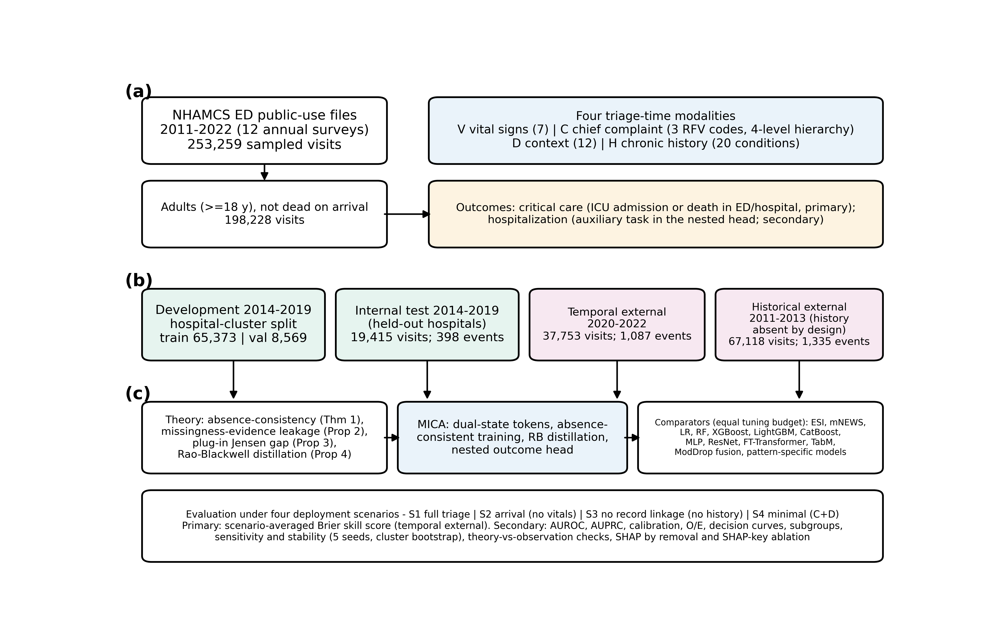
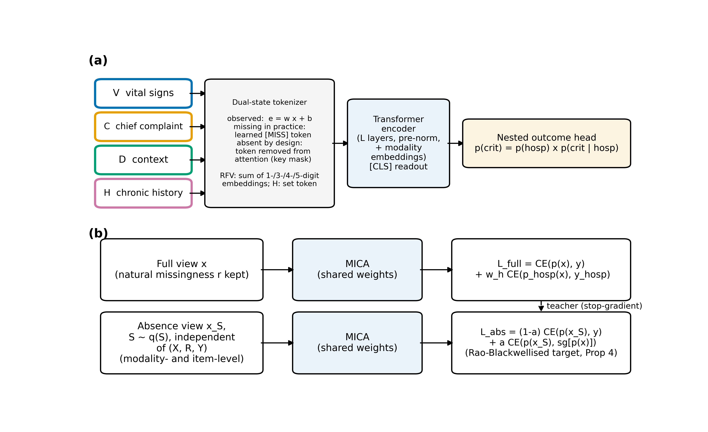
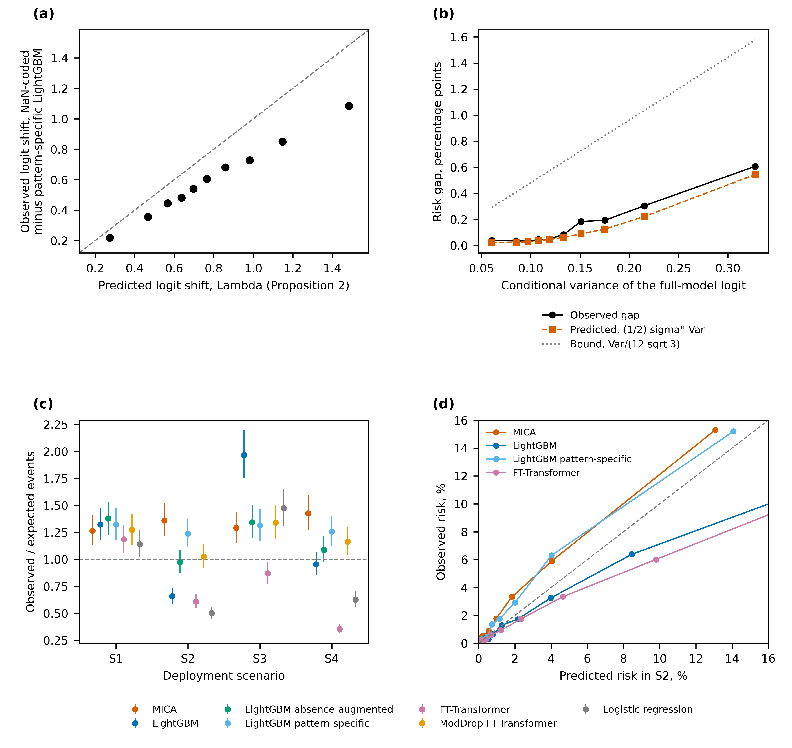
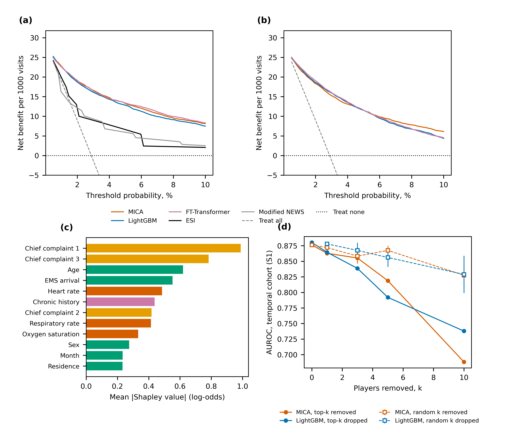

# MICA: Absence-Consistent Multimodal Fusion for Emergency Department Triage

## Overview

Clinical inputs can be unavailable for two different reasons: they may be **missing in practice**, where non-recording itself can be informative, or **absent by design**, where a hospital or deployment setting never collects an entire modality. Treating both mechanisms as ordinary missingness can distort predicted risk.

**MICA** separates these mechanisms and trains one multimodal model to produce consistent critical-care risk estimates across different modality-availability patterns.

The study used **198,228 adult emergency department visits** from the US National Hospital Ambulatory Medical Care Survey (NHAMCS), 2011–2022.

> This public repository contains a study overview and selected main figures. Code, data, manuscripts, tables, and supplementary files remain private.

## Study design

Four triage-time modalities were considered:

- vital signs;
- chief complaint;
- arrival and visit context;
- chronic-condition history.

Development used 2014–2019 data with hospital-cluster separation. Evaluation included held-out hospitals, temporal validation in 2020–2022, and a historical 2011–2013 cohort in which most chronic-history variables were not collected.

The primary outcome was ICU admission or death. The primary endpoint was scenario-averaged Brier skill score across four deployment patterns.

## Model

MICA uses modality tokens, explicit availability states, and a shared transformer. During training, a second view removes modalities independently of patient characteristics. A consistency objective teaches the model to marginalize modalities that are absent by design while retaining the prognostic information carried by genuine missingness in the observed modalities.

## Main findings

| Result | Estimate |
|---|---:|
| Temporal scenario-averaged Brier skill score | **0.127** (95% CI 0.111–0.144) |
| AUROC with all modalities | **0.883** (95% CI 0.872–0.894) |
| LightGBM AUROC with all modalities | 0.882 |
| Emergency Severity Index AUROC | 0.725 |
| MICA sensitivity at ESI 1–2 alert volume | **74.8%** |
| ESI sensitivity at the same volume | 63.9% |
| Historical-cohort AUROC | **0.899** |

MICA exceeded 12 of 14 prespecified comparators for the primary endpoint after multiplicity correction. Its difference from the closest absence-aware comparator, ModDrop FT-Transformer, was small and not statistically significant.

When vital signs were absent by design, LightGBM over-predicted risk (observed-to-expected ratio 0.659). When chronic history was absent, a pattern unsupported in training, standard boosted models also became unstable. MICA maintained much more consistent calibration across deployment patterns.

The theoretical predictions were supported empirically: the risk shift caused by incorrectly encoding designed absence tracked the predicted shift, and plug-in imputation under-predicted risk in proportion to conditional uncertainty.

MICA and strong learned comparators had similar net benefit, while all clearly outperformed ESI. Chief-complaint information had the largest modality-level contribution; performance declined gradually under feature removal and input noise.

## Interpretation

The central contribution is consistency across collection settings. MICA does not claim a large discrimination advantage over the strongest machine-learning comparators when all inputs are present. Its value appears when a modality is unavailable for an entire deployment setting and calibrated probabilities are required from one shared model.

## Limitations

- NHAMCS is a national survey rather than a prospective real-time deployment.
- Some deployment scenarios were simulated by masking recorded modalities.
- The historical cohort provides real designed absence but also differs temporally.
- Prospective validation and workflow impact assessment are still needed.

## Repository scope

Public contents are limited to `README.md` and four selected main figures under `assets/`. This project is for research communication and is not intended for clinical use.
